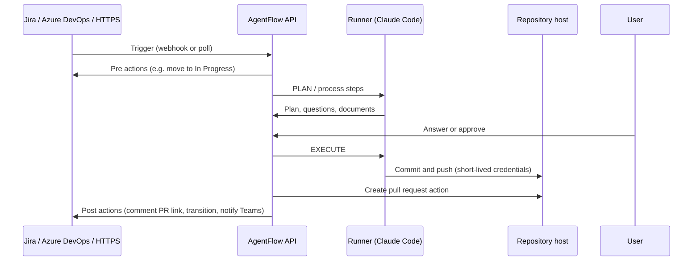

<p align="center">
  <picture>
    <source media="(prefers-color-scheme: dark)" srcset="packages/design-system/brand/logos/Horizontal/agentflow-logo-horizontal-on-dark.svg" />
    
  </picture>
</p>

<p align="center">
  The self-hosted workspace for team-based agentic software development.
</p>

<p align="center">
  <a href="LICENSE"></a>
  
  
  
</p>

<p align="center">
  <a href="#quick-start">Quick Start</a> &middot;
  <a href="#install-a-headless-runner">Install a Runner</a> &middot;
  <a href="#features">Features</a> &middot;
  <a href="#architecture">Architecture</a> &middot;
  <a href="docs/self-hosting.md">Self-hosting</a> &middot;
  <a href="docs/workflows.md">Workflows</a> &middot;
  <a href="docs/runner.md">Runners</a>
</p>

---

AgentFlow is a platform where AI agent teams produce delivery artifacts (PRDs, implementation plans, code, pull requests) and humans review them at every stage. Tickets from Jira, Azure DevOps or any HTTPS source trigger workflows; agents plan and implement on your own runners; every write back to an external system is an action you configure.

Repository: **https://github.com/daominhsangvn/agentflow**

## Quick Start

**Prerequisites:** Node.js 24+, pnpm, Docker, and the [Claude Code](https://docs.anthropic.com/en/docs/claude-code) CLI on the machine that runs agents.

```bash
git clone https://github.com/daominhsangvn/agentflow.git
cd agentflow
pnpm install
cp .env.docker.example .env        # optional: change host ports / credentials
docker compose up -d               # PostgreSQL, RustFS (S3), Mailpit, Local Git
pnpm storage:init                  # create buckets + browser CORS (idempotent)
pnpm local-git:init                # optional: Local Git admin account + token
pnpm migrate                       # database migrations
pnpm dev                           # start all apps
```

Open [http://localhost:3000](http://localhost:3000) and sign up. The first account creates the organization and becomes its owner.

> The first `pnpm dev` creates `.env.local` files from the `.env.example` templates. See [Self-hosting](docs/self-hosting.md) for every variable (`DATABASE_URL`, `S3_*`, `ENCRYPTION_KEY`, `SMTP_URL`, auth options).

### Backing services

Everything runs locally; no AWS, Vercel or hosted auth service is needed.

| Service | Required | Purpose |
|---------|----------|---------|
| PostgreSQL 16 | Yes | Application database (`docker compose`) |
| RustFS | Yes | S3-compatible storage: attachments, transcripts, loop state (`docker compose`) |
| Better Auth | Built in | Local email/password accounts and organizations, inside `apps/api` |
| Claude Code CLI | For agent runs | Runs the agent team on desktop or headless runners; any Anthropic-compatible endpoint works |
| Mailpit | Development | Captures invitations and password resets at http://localhost:8025 |
| Local Git (Gitea) | Optional | Git hosting on this machine for projects without a remote (http://localhost:3300) |
| [Liveblocks](https://liveblocks.io) | Optional | Live co-editing of documents; without it, edits are saved as versions |
| [PostHog](https://posthog.com) | Optional | Analytics and feature flags (flags can be set by env instead) |

### Common Commands

```bash
pnpm dev                                    # Start all apps
pnpm turbo dev --filter=app --filter=api    # Start specific apps
pnpm build                                  # Build everything
pnpm typecheck                              # TypeScript check
pnpm lint                                   # Lint (Biome)
pnpm test                                   # Unit tests
pnpm test:e2e                               # Playwright end-to-end tests
pnpm migrate                                # Database migrations
pnpm storage:init                           # Object storage buckets + CORS
pnpm local-git:init                         # Local Git account + token
```

## Install a headless runner

Agent loops run on **compute targets**. A headless runner executes them on a server, a VM or a Docker container, with no desktop app. It connects outwards to the AgentFlow API, so it needs no open port. Install as many as you need: each one shows up as its own compute target. The full guide is [docs/runner.md](docs/runner.md).

### 1. Before you install

| You need | Where to get it |
|----------|-----------------|
| The AgentFlow API URL, reachable from the runner | Use https. Plain http works only for `localhost` or for hosts listed in `AGENTFLOW_ALLOW_HTTP_HOSTS` (a network you trust). |
| An API key (`sk_live_…`, `write` scope) | AgentFlow → Settings → API Keys. The runner registers as a compute target of the key's owner; a dedicated bot user is a good owner. |
| Claude credentials | **Recommended:** set them in AgentFlow after installing, under the runner's **Model provider** (Anthropic or any Anthropic-compatible API such as DeepSeek). Nothing is written to the runner's disk. **Or** set `CLAUDE_CODE_OAUTH_TOKEN` (from `claude setup-token`) or `ANTHROPIC_API_KEY` on the runner. |
| Repository access | Nothing to set up: project repositories are cloned with short-lived credentials the API issues for each loop. `GH_TOKEN` is optional, for agents that call `gh` or reach other GitHub repositories. |

### 2a. Docker (recommended)

Build the base image from the repository root. It contains Node.js 24, git, gh, jq, python3, ripgrep, Claude Code, the runner and the plugins, and runs as the unprivileged user `runner`.

```bash
docker buildx build -f deploy/runner/Dockerfile -t agentflow-runner:base .
```

Put the configuration in an env file, e.g. `runner-1.env`. Keep it private: it holds the API key.

```bash
AGENTFLOW_API_URL=https://agentflow.example.com
AGENTFLOW_API_KEY=sk_live_...
AGENTFLOW_RUNNER_NAME=runner-1
# Only when no model provider is set in AgentFlow:
# CLAUDE_CODE_OAUTH_TOKEN=...
```

Start the runner. The four volumes keep its repositories, its identity (so it stays the same compute target across restarts), its Claude state and its learnings.

```bash
docker run -d --name agentflow-runner-1 --restart unless-stopped \
  --env-file runner-1.env \
  -v agentflow-runner-1-workspace:/workspace \
  -v agentflow-runner-1-data:/home/runner/.agentflow-runner \
  -v agentflow-runner-1-claude:/home/runner/.claude \
  -v agentflow-runner-1-learnings:/home/runner/.agentflow-ai \
  agentflow-runner:base

docker logs -f agentflow-runner-1      # startup checks and connection state
```

`docker ps` shows the container as `healthy` once it is connected.

**API on the same machine (Docker Desktop):**
- Use `AGENTFLOW_API_URL=http://host.docker.internal:3002` and `AGENTFLOW_ALLOW_HTTP_HOSTS=host.docker.internal`.
- Set the Local Git connection's **Runner URL** to `http://host.docker.internal:3300`.
- Set `S3_PUBLIC_ENDPOINT` (in `apps/api/.env.local`) to `http://host.docker.internal:<S3_PORT>`, so runners can reach presigned storage URLs.
- In Git Bash on Windows, run `docker` with `MSYS_NO_PATHCONV=1` and pass the env file as a Windows path (`--env-file C:/path/runner-1.env`).

**Project toolchains.** Agents build and test what they change, so the runner needs each project's toolchain. Extend the base image: see `deploy/runner/examples/node-project.Dockerfile` and `deploy/runner/examples/tauri-project.Dockerfile` (Rust + Tauri 2).

```dockerfile
FROM agentflow-runner:base
USER root
RUN apt-get update && apt-get install -y --no-install-recommends build-essential \
    && rm -rf /var/lib/apt/lists/*
USER runner
```

A toolchain installed outside `/usr/bin` (`~/.cargo/bin`, a .NET install in `/opt`, …) must be added to `PATH` in `/etc/profile.d/<tool>.sh`, not only with `ENV PATH=`. The runner reads `PATH` from a login shell.

**Upgrade:** rebuild the image, then `docker rm -f agentflow-runner-1` and run `docker run` again with the same name, env file and volumes. Upgrade while the runner is idle: stopping it abandons the loops it is running.

### 2b. Ubuntu / Debian server (systemd)

Supported on Ubuntu 22.04/24.04 and Debian 12 (x86_64 or arm64). Use this when a project's tests need Docker themselves, and run it on a dedicated VM.

```bash
# On a machine with the repository (Node.js 22+, pnpm):
pnpm install
pnpm -C apps/desktop package:headless
# → apps/desktop/dist-headless/agentflow-runner-<version>-linux.tar.gz

# On the server:
tar -xzf agentflow-runner-*-linux.tar.gz
sudo bash agentflow-runner/install.sh
sudoedit /etc/agentflow-runner/runner.env   # AGENTFLOW_API_URL, AGENTFLOW_API_KEY, AGENTFLOW_RUNNER_NAME, ...
sudo systemctl start agentflow-runner
journalctl -u agentflow-runner -f
```

The installer adds Node.js, git, gh, jq, python3 and Claude Code. It creates the `agentflow-runner` user, installs the runner to `/opt/agentflow-runner` and enables `agentflow-runner.service`. Install each project's toolchain on the server yourself. To upgrade, run `install.sh` from a new package.

### 2c. Development (Linux, macOS, WSL2)

```bash
pnpm install
pnpm -C apps/desktop build:headless
export AGENTFLOW_PLUGINS_DIR="$PWD/agent-plugins"
export AGENTFLOW_API_URL=http://localhost:3002 AGENTFLOW_API_KEY=sk_live_... AGENTFLOW_RUNNER_WORKSPACE=~/agentflow-work
node apps/desktop/dist-headless/runner.mjs
```

Native Windows is not supported, because loops run through `bash`. Use Docker Desktop or WSL2.

### 3. After installing

1. The runner appears **online** under Settings → Compute & Integrations → Local Compute Targets.
2. Open it and set its **Model provider**, unless the runner has its own Claude credential.
3. **Share it with the organization** if workflows run as other users.
4. Assign it to projects (Project → Repositories → Runners; loops are balanced across a project's online runners), or select it as a workflow's compute target (Workflows → edit → Agent team).

Useful variables: `AGENTFLOW_RUNNER_MAX_CONCURRENT` (loops at once, default 2), `AGENTFLOW_RUNNER_WORKSPACE` (default `/workspace`), `AGENTFLOW_RUNNER_REPORT_SESSIONS` (report loops to Sessions/Agents, default `true`). See [docs/runner.md](docs/runner.md) for the full table, troubleshooting and the secret guard.

> **Security:** a runner executes code that agents write from ticket content. Keep it in a container or a dedicated VM, and never on a server that holds production data or other services' secrets.

## Features

### Self-hosted edition

- One `docker compose up` brings up every backing service: PostgreSQL, RustFS (S3), Mailpit and Local Git.
- Secrets at rest (integration tokens, model provider keys) are sealed with AES-256-GCM (`ENCRYPTION_KEY`).
- An in-process scheduler replaces Vercel cron: workflow ticks, loop timeouts and stale-session reconciliation.
- Feature flags work without PostHog through `AGENTFLOW_FEATURE_FLAGS` / `NEXT_PUBLIC_AGENTFLOW_FEATURE_FLAGS`.

### Local accounts and organizations

Authentication is [Better Auth](https://better-auth.com) inside `apps/api`, behind the `@repo/auth` facade. It is single-tenant by default: the first account owns the organization, later accounts join as members, and owners invite people from Settings → Organization. Invite-only mode is `AUTH_ALLOW_SIGN_UP=false`.

### Workflows and integrations

```
trigger(s)  ->  pre actions  ->  agent team  ->  post actions
```

- **Triggers:** a Jira issue or Azure DevOps work item assigned to the bot, or a signed HTTPS request (every workflow has a built-in HTTP trigger). Connections receive webhooks or poll when there is no public URL.
- **Pre actions** run in order before the agent team, e.g. move the ticket to "In Progress".
- **Post actions** run on run events (plan ready, needs input, succeeded, failed), e.g. comment the PR link, transition the ticket, post to Microsoft Teams, call an HTTPS endpoint, run a pipeline.
- **The engine never writes to a source system on its own.** Every external change is an action the admin added.
- **Providers:** Jira, Azure DevOps, GitHub, Bitbucket Cloud, Local Git, Microsoft Teams and HTTPS webhooks. Each one is a plugin in `apps/api/lib/integrations/providers/` that declares its triggers, actions and capabilities. A connection is the only place credentials live.

See [docs/workflows.md](docs/workflows.md).

### Project repositories

- A project picks its repositories from any connection with the `repositories` capability (GitHub with a fine-grained PAT, Azure Repos, Bitbucket, Local Git). Up to 20 repositories per project, all equal, with no primary repo.
- Agents work in one loop workspace that holds a worktree per repository, plus a generated root `CLAUDE.md` built from the project's **Agent instructions**.
- Agents only commit and push. Pull requests come from the workflow's **Create pull request** action, one PR per pushed repository.
- Runners never hold repository tokens. They get short-lived git credentials for each loop from the API.

### Local Git

Projects without a remote use the bundled Gitea (`local-git` service): create repositories from Project → Repositories, then browse code, commits and branches, or download them, in Gitea's UI. See [docs/local-git.md](docs/local-git.md).

### Configurable project process

- The steps between pre and post actions are a per-project **process**, edited as YAML in the app (Project → Process) with completion and inline lint.
- Without a process, the built-in flow (PLAN, then optional EXECUTE) runs unchanged.
- **Agent steps** run as `STEP` loops. They can run a toolkit's slash commands (for example Spec Kit), ask questions, publish a file as a project document (PRD, implementation plan, doc) and push their changes.
- **Approval steps** wait for an admin. Answers given on the ticket or in AgentFlow resume the asking agent's session.
- A workflow can carry its own process, so one project can run a different flow per work type (bug, change request, PRD, Q&A).

### PRDs as source documents

A source item whose type is a product requirement (`prd`) is imported as a **PRD** document, and the plan is generated from it. Bugs and tickets stay **Issues**.

### Headless runners

- Agent loops run on compute targets: the desktop app, or **headless runners** (a Docker image `agentflow-runner:base` with per-toolchain images, or a systemd service on Ubuntu/Debian). Runners only connect outwards.
- A project can list its runners, and loops are balanced across the online ones.
- The model provider is configured per compute target in the UI (Anthropic or any Anthropic-compatible endpoint, such as DeepSeek). It is stored sealed and sent with each loop, never written to the runner's disk.
- A **secret guard** hook, on by default, stops agents from reading secret files, secret-looking content or environment dumps.
- Runners report their sessions, transcripts and agent usage to the **Sessions** and **Agents** pages.

See [docs/runner.md](docs/runner.md).

### Claude Code plugins

The AgentFlow plugins (`code`, `code-review`, `judges`, `platform`, `self-learning`, `bootstrap`) are vendored in `agent-plugins/` and passed to every `claude` run with `--plugin-dir`. Nothing is installed into `~/.claude/plugins`.

## Architecture

Next.js monorepo with Turborepo.

### Apps

| App | Port | Description |
|-----|------|-------------|
| **app** | 3000 | Main application: dashboard, documents, projects, workflows, sessions |
| **api** | 3002 | API server: database, auth, integrations, workflow engine, desktop gateway socket |
| **web** | 3001 | Marketing site |
| **mcp** | 3010 | MCP server for the Claude Code CLI |
| **relay** | 3020 | WebSocket relay for desktop compute |
| **storybook** | 6006 | Component library |
| **studio** | 3005 | Prisma Studio, a database browser |
| **desktop** | — | Electron desktop app (localhost gateway, agent monitor) and the source of the headless runner |
| **prototypes** | 3030 | Mock-data UI prototype sandbox |

### Packages

Shared packages imported as `@repo/<name>`:

| Package | Purpose |
|---------|---------|
| **database** | Prisma ORM, schema, migrations |
| **api** | Shared type definitions (wire contracts for workflows, integrations, processes) |
| **auth** | Better Auth facade: server `auth()`, middleware, client hooks |
| **storage** | S3-compatible object storage (RustFS) |
| **ai** | Claude integration |
| **github** | GitHub API helpers |
| **design-system** | UI components (Shadcn + Tailwind) |
| **rich-text** | TipTap editor with Mermaid |
| **collaboration** | Real-time editing (Liveblocks, optional) |
| **analytics** | PostHog + Google Analytics |
| **observability** | Structured logging |
| **email** | Transactional email (SMTP or Resend) |
| **security** | Security headers (Nosecone) |
| **telemetry-contract** | Agent session telemetry schemas |

### Core workflow



### Desktop app

`apps/desktop` is an Electron app that runs a localhost gateway for local agent execution, with a built-in agent monitor. The headless runner is built from the same source (`apps/desktop/src/headless/`).

```bash
pnpm desktop:dev          # Run the desktop app in development
pnpm desktop:build        # Build main + renderer bundles
pnpm desktop:package      # Produce a distributable in apps/desktop/dist-dmg
```

Packaging produces an unsigned (ad-hoc) build by default, so no Apple credentials are required. Service origins can be overridden with `AF_RELAY_ORIGIN`, `AF_WEB_APP_ORIGIN` and `AF_AUTH_API_ORIGIN`. See `apps/desktop/README.md`.

## Documentation

- **[Self-hosting](docs/self-hosting.md)**: services, environment variables, authentication, feature flags
- **[Workflows and integrations](docs/workflows.md)**: triggers, actions, providers, project process, repositories
- **[Headless runner](docs/runner.md)**: Docker / systemd install, toolchains, secret guard, sessions
- **[Local Git](docs/local-git.md)**: bundled Git hosting for projects without a remote
- **[End-to-end tests](docs/e2e.md)**: Playwright setup and the test account
- **[Local Deployment Guide](docs/local_deployment.md)**: full setup and troubleshooting
- **[Database Schema](docs/database-schema.md)**: entity relationships and data model
- **[GitHub App Setup](docs/github-app-setup.md)**: optional GitHub App (Branches view)
- **[Product Overview](project-overview.md)**: system architecture and API surface

## Contributing

We welcome contributions. See **[CONTRIBUTING.md](CONTRIBUTING.md)** for conventions, code style, and testing requirements.

```bash
# Fork on GitHub, then:
git clone https://github.com/YOUR_USERNAME/agentflow.git
cd agentflow
git remote add upstream https://github.com/daominhsangvn/agentflow.git
pnpm install && docker compose up -d && pnpm dev
```

## Troubleshooting

| Problem | Fix |
|---------|-----|
| `pnpm typecheck` fails with "Property does not exist" | `pnpm install && cd packages/database && pnpm prisma generate` |
| API answers "Unknown field ... for select" after a schema change | Restart the API dev server so it loads the regenerated Prisma client |
| Environment variable validation errors | Comment out unused vars (empty `""` fails validation) |
| Database connection issues | `docker compose up -d` and check `DATABASE_URL` in `.env.local` |
| Attachments or session transcripts fail in the browser | Run `pnpm storage:init` (buckets + CORS); check `S3_PUBLIC_ENDPOINT` is reachable from browsers and runners |
| RustFS unreachable on Windows | Hyper-V may reserve the port range: check `netsh int ipv4 show excludedportrange protocol=tcp`, then move `S3_PORT` / `S3_CONSOLE_PORT` (e.g. 9100/9101) |
| Routes answer 404 with "Compiling /_not-found" | Stop the server, delete `apps/api/.next/dev` (or `apps/app/.next/dev`), restart |

## Legacy Identifiers

Some internal identifiers use "Symphony" (an earlier codename). They don't affect the product and are kept to avoid breaking runtime behavior, e.g. `/api/gateway/symphony/*` routes and `symphony_loop` operations.

## License

[MIT](LICENSE)
